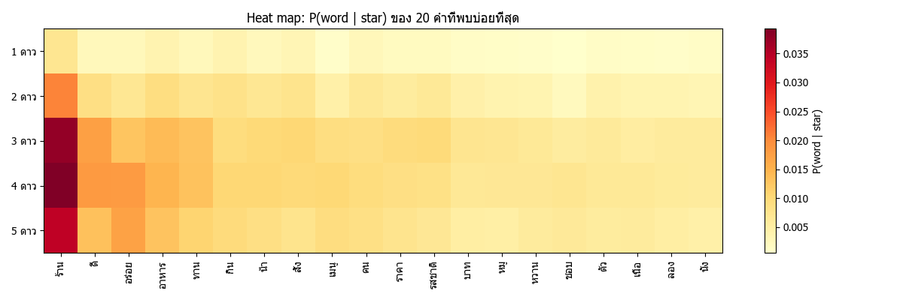

# Naive Bayes Sentiment Analysis – Wongnai Reviews

จำแนกรีวิวร้านอาหารภาษาไทย (Wongnai) เป็น 1–5 ดาว ด้วย **Multinomial Naive Bayes ที่เขียนเอง**

## ขั้นตอน
1. ตัดคำ (ข้อมูลตัดคำมาแล้วด้วย `|`)
2. ลบ stop words (PyThaiNLP)
3. นับคำแต่ละคลาส (TF)
4. Laplace smoothing: `P(w|c) = (count + 1) / (คำทั้งหมดในคลาส + |V|)`
5. ทำนาย: เลือกคลาสที่ `log P(c) + Σ log P(w|c)` มากที่สุด
6. Heat map, Word cloud
7. วัด Accuracy กับชุด test

## โครงสร้าง
```
data/            (ตัดคำแล้ว) + ไฟล์ label
data/original/   ชุดข้อมูล Wongnai ต้นฉบับ (รีวิว + คะแนนดาว 1-5)
results/     กราฟผลลัพธ์
naive_bayes.py      โปรแกรมหลัก (Naive Bayes + Accuracy)
plots.py            วาด heat map / word cloud
prepare_labels.py   ดึง label ดาวมาเก็บไว้ (รันครั้งเดียว ทำไว้แล้ว)
```

## วิธีรัน
```bash
pip install -r requirements.txt
python naive_bayes.py
```

## ที่มาของข้อมูล
Wongnai Reviews: https://github.com/wongnai/wongnai-corpus (LGPL-3.0)
ไฟล์ของอาจารย์ไม่มีคะแนนดาว จึงใช้คอลัมน์ `star_rating` จากไฟล์ต้นฉบับใน `data/original/`
(`python prepare_labels.py` จะสร้าง `train_labels.txt` / `test_labels.txt`)

## ผลลัพธ์
- Train 40,000 รีวิว / Test 6,203 รีวิว
- **Accuracy = 52.09%** (3,231 / 6,203)
- ข้อมูลไม่สมดุล (1 ดาวมีแค่ 1%, 4 ดาวมี 47%) โมเดลจึงทายคลาส 1–2 ดาวได้ยาก



